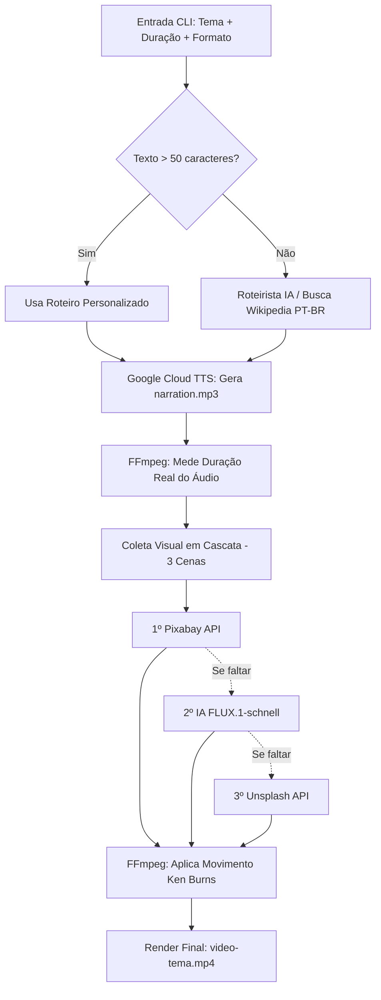

# 🎬 VideoCreator

[](https://nodejs.org/)
[](https://ffmpeg.org/)
[](https://cloud.google.com/text-to-speech)
[](https://huggingface.co/)
[](LICENSE)

> **Gerador automatizado de vídeos curtos e tradicionais via linha de comando (CLI).**  
> Transforme qualquer tema ou roteiro em vídeos prontos para **TikTok, YouTube Shorts, Instagram Reels (9:16)** ou **YouTube Tradicional (16:9)** com roteirização por IA, narração neural humanizada, curadoria híbrida de imagens (Banco de Imagens + IA) e animação dinâmica de câmera.

---

## 🎥 Demonstração

> 💡 *Salve o GIF gerado na pasta `assets/demo.gif` do seu repositório para que a prévia seja exibida automaticamente no GitHub.*

<div align="center">
  
</div>

---

## ✨ Funcionalidades Principais

* 🧠 **Roteirista Criativo & Enciclopédico:** Gera explicações inéditas, cativantes e proporcionais ao tempo escolhido via LLM (com *fallback* inteligente via busca semântica na Wikipedia em PT-BR) ou aceita seu próprio roteiro completo.
* 🎙️ **Locução Neural Humanizada:** Integração nativa com **Google Cloud Text-to-Speech (`pt-BR-Neural2-B`)** para narração fluida e natural em português.
* ⏱️ **Sincronização Automática de Duração:** Mede a duração exata do áudio sintetizado via FFmpeg e ajusta o tempo das cenas automaticamente para nunca cortar a fala nem deixar silêncios sobrando.
* 🖼️ **Pipeline Visual Híbrido em Cascata (3 Camadas):**
  1. **Pixabay API:** Busca prioritária de fotografias reais em alta definição na orientação exata do vídeo.
  2. **IA Generativa (`FLUX.1-schnell` via Hugging Face ZeroGPU):** Gera cenas personalizadas automaticamente caso o banco primário não cubra todo o roteiro.
  3. **Unsplash API:** Camada complementar de fotografias editoriais para garantir 100% de cobertura visual.
* 🎥 **Animação Cinematográfica (Efeito Ken Burns):** Aplica movimentos suaves de *Zoom In* e *Zoom Out* em alta taxa de quadros (`zoompan` com *upscaling* anti-tremor) antes de compilar o `.mp4` final.

---

## 🏗️ Arquitetura do Fluxo



---

## 📋 Pré-requisitos

* **Node.js** `v18.0.0` ou superior instalado.
* Uma conta no **Google Cloud** com a API **Cloud Text-to-Speech** ativada e o arquivo de chave de serviço (`credentials.json`).
* Chaves gratuitas (sem necessidade de cartão de crédito) para as fontes de imagem:
  * [Pixabay API Key](https://pixabay.com/api/docs/)
  * [Hugging Face Access Token](https://huggingface.co/settings/tokens)
  * [Unsplash Access Key](https://unsplash.com/developers)

---

## 🚀 Instalação e Configuração

### 1. Clone o repositório e instale as dependências

```bash
git clone https://github.com/erasmofreire/VideoCreator.git
cd VideoCreator
npm install
```

*(O binário do FFmpeg é gerenciado automaticamente pelo pacote `@ffmpeg-installer/ffmpeg`, dispensando instalação manual no sistema).*

### 2. Configure as credenciais do Google Cloud

Coloque o arquivo JSON da sua conta de serviço na raiz do projeto com o nome `credentials.json` (ou informe o caminho desejado no `.env`).

### 3. Configure as variáveis de ambiente

Crie um arquivo `.env` na raiz do projeto com o conteúdo abaixo:

```env
# Credenciais Google Cloud TTS
GOOGLE_APPLICATION_CREDENTIALS=credentials.json

# Fontes de Imagens em Ordem de Prioridade
PIXABAY_API_KEY=sua_chave_pixabay_aqui
HF_TOKEN=hf_seu_token_huggingface_aqui
UNSPLASH_ACCESS_KEY=sua_access_key_unsplash_aqui
```

---

## ▶️ Como Usar

Execute o script principal no terminal:

```bash
node createVideo.js
```

Siga as instruções interativas no console:

```text
====================================================
   VIDEOCREATOR V11 - PIXABAY -> IA FLUX -> UNSPLASH
====================================================
[Status .env] 1. PIXABAY_API_KEY detectada
[Status .env] 2. HF_TOKEN detectado (IA FLUX ativa)
[Status .env] 3. UNSPLASH_ACCESS_KEY detectada

Tema ou texto completo da narracao (default: Ferrari): Inteligência Artificial
Duracao desejada do video em segundos (default: 30): 30

Escolha o formato do video:
1: TikTok / Shorts / Reels (9:16)
2: YouTube Tradicional (16:9)
Opcao (default: 1): 1
```

Ao final do processamento, o vídeo pronto será salvo na pasta raiz com o nome sanitizado do tema (ex.: `video-inteligencia-artificial.mp4`) e os clipes temporários serão removidos automaticamente.

---

## 📁 Estrutura do Projeto

```text
VideoCreator/
├── assets/
│   └── demo.gif         # GIF animado de demonstração do projeto
├── createVideo.js       # Orquestrador principal (Roteiro, TTS, Imagens e FFmpeg)
├── credentials.json     # Chave de conta de serviço Google Cloud (ignorado no Git)
├── .env                 # Chaves de API e configurações locais (ignorado no Git)
├── package.json         # Dependências do projeto
└── README.md            # Documentação
```

---

## 🛠️ Tecnologias Utilizadas

* **[Node.js](https://nodejs.org/)** — Ambiente de execução JavaScript.
* **[@google-cloud/text-to-speech](https://www.npmjs.com/package/@google-cloud/text-to-speech)** — Síntese de voz neural em português.
* **[fluent-ffmpeg](https://www.npmjs.com/package/fluent-ffmpeg) & [@ffmpeg-installer/ffmpeg](https://www.npmjs.com/package/@ffmpeg-installer/ffmpeg)** — Processamento de vídeo, filtros `zoompan`, análise de duração de áudio e codificação `H.264 / AAC`.
* **[Axios](https://axios-http.com/)** — Comunicação com APIs REST e streams SSE.
* **[readline-sync](https://www.npmjs.com/package/readline-sync)** — Interface interativa via terminal.

---

## 📄 Licença

Este projeto está sob a licença MIT. Sinta-se à vontade para usar, modificar e expandir para suas automações de conteúdo.